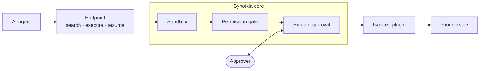

<p align="center">
  <picture>
    <source media="(prefers-color-scheme: dark)" srcset="docs/assets/synoikia-lockup-dark.svg" />
    
  </picture>
</p>

<p align="center"><strong>Give AI agents access to your systems, with the controls your security team expects</strong></p>

<p align="center">Synoikia is one MCP server in front of all your internal services. Every agent call passes the same permission gate, human approval, secret redaction and audit log.</p>

<p align="center">
  <a href="#why-synoikia">Why</a> ·
  <a href="#how-it-works">How it works</a> ·
  <a href="#features">Features</a> ·
  <a href="#get-started">Get started</a> ·
  <a href="#plugins-and-integrations">Plugins</a> ·
  <a href="#learn-more">Learn more</a>
</p>

> [!WARNING]
> This tool is in early development. Expect breaking changes, missing features, and bugs. It is not yet recommended for production use.

---

## Why Synoikia

Teams want agents to work in their real systems: the NAS, the ticketing tool, the media stack, building automation. Each MCP server that connects them makes its own security decisions. Some run every write at once. Some let the agent approve its own actions. Each has its own logins, secret handling and logs, or none.

That leaves security and compliance teams with questions that nobody can answer:

- Which agent can change what, and who decided that?
- Who approved the call that deleted that dataset?
- Did an API key end up in a chat transcript?
- How do we revoke a person's agents when that person leaves?

Synoikia answers them in one place. The security controls live in Synoikia core and apply to every integration. A plugin only describes its service's API. It never decides what is allowed.

### It also cuts the cost of each session

A typical MCP server loads one tool definition per operation into the model's context, at the start of every session. Synoikia uses the [Code Mode][code-mode] pattern instead. Each endpoint has three tools: `search`, `execute` and `resume`. The agent finds only the operations it needs, so the cost stays flat however large the upstream API is.

| Integration | Classic MCP server                                             | Context cost                                           | With Synoikia                             |
| ----------- | -------------------------------------------------------------- | ------------------------------------------------------ | ----------------------------------------- |
| TrueNAS     | 52 hand-picked tools                                           | ~15–20K tokens                                         | ~1–3K tokens, all ~650–700 methods        |
| Grafana     | Official mcp-grafana 2.1.1: 82 tools on by default, 127 in all | ~17–20K tokens by default, ~26–30K with every category | ~1–3K tokens, all 310 HTTP API operations |

_TrueNAS: measured by the Synoikia team in September 2026. Grafana: tool counts from [mcp-grafana 2.1.1][mcp-grafana], collected October 24, 2026. Its token cost is an estimate from that source._

The cost shows up in two places:

- **API bills for heavy users.** An agent sends the tool definitions again with each request. You pay for those tokens on every request, for every agent and every session, even when the task uses one tool.
- **Room on free and smaller plans.** These plans have smaller context windows. Tool definitions take space before the first message, so long tasks run out of room sooner.

### No new release when the API changes

Most MCP servers hard-code their tools, so a new upstream version waits for a new server release. A Synoikia plugin reads its catalog from the API itself, such as the OpenAPI description that Grafana serves. Synoikia syncs it when the upstream version changes and once a day. New endpoints show up without an update. Access never widens on a sync: a new or changed write stays closed or asks until an admin opens it.

## How it works



Each service gets its own endpoint, such as `https://mcp.example.com/nas`. Every call takes the same path, whatever the service. Core redacts secrets and audits the call at each step. The admin portal runs on its own port.

## Features

The [security model](docs/security-model.md) explains each control in detail.

### Least-privilege access

- **Access levels for each operation:** None, Read, Ask or Write, for a group or a single operation. New groups start at Ask, and an operation that nobody can classify counts as a write.
- **Locked by default:** destructive operations stay off until an admin opens them. Then they always need a human and a typed confirmation.
- **Roles and rate limits:** a role caps what its users' agents can reach, and each credential has its own budget of runs and writes.

### Human approval that the agent cannot fake

- **A separate approval page:** the owner of the agent's credential decides, and sees the exact targets and each config change before and after.
- **In the chat app:** Claude and ChatGPT show an approval card in the conversation. Other apps get a link, and the call waits.
- **Pre-approval rules and session grants** approve routine calls or a batch job with no prompt. Locked operations always ask.

### Identity and access

- **Single sign-on** with any OIDC provider, an access gateway such as Cloudflare Access, or local accounts with TOTP.
- **Agent sign-in** with OAuth 2.1, bearer tokens or the gateway, set for the server and for each endpoint.
- **One-step offboarding:** disable a user, and all their agents lose access at once.

### Audit and secrets

- **An audit log** of every call, approval, sign-in and admin change, with who did it. Export it as a spreadsheet.
- **Secrets encrypted at rest** and never shown, not even to admins.
- **Redaction** hides secrets from agent results, approvals, logs and the audit log.

### Defense in depth

- **Sandboxed agent code** in [`isolated-vm`][isolated-vm], with no network or file system.
- **Isolated plugins,** each in its own process with only its own secrets.
- **Signed plugins,** each build checked against the publisher's [minisign][minisign] key.

### Easy to run

- **One deployment** in place of many MCP servers: one Docker image, one portal.
- **Self-maintaining:** catalogs sync with the upstream, crashed plugins restart, and upgrades migrate the data.
- **Prometheus metrics and notifications** to [ntfy][ntfy] or a signed webhook.

## Who it is for

| Who                       | What Synoikia gives them                                                                             |
| ------------------------- | ---------------------------------------------------------------------------------------------------- |
| IT and platform teams     | One place to connect agents to self-hosted systems, with roles, SSO and a single deployment to patch |
| Security and compliance   | Least privilege, human approval for risky actions, redaction and an exportable audit trail           |
| Team leads and staff      | Agents that can do real work, with approvals in the chat app they already use                        |
| Managed service providers | Separate instances and endpoints for each environment, under one policy                              |
| Homelabs and households   | The same controls for a home server, with a role for each person                                     |

## Get started

```sh
cp .env.example .env   # set MASTER_KEY, PUBLIC_MCP_URL, …
docker compose -f docker-compose.example.yml up -d
```

This pulls `ghcr.io/synoikia-org/synoikia`. Pin a version tag in production.

1. Put port 8080 behind your reverse proxy as the public MCP host name, and set `PUBLIC_MCP_URL` to it.
2. Open the admin portal on port 8081 and make the first account. It gets the Admin role.
3. Connect your identity provider, and add roles for your teams.
4. Install plugins, add an instance, and raise the access groups you want above Read.
5. Connect your MCP client to `PUBLIC_MCP_URL/<instance>`.

Reverse proxy settings, metrics, network egress, master key rotation and troubleshooting are in the [deployment guide](docs/deployment.md).

## Plugins and integrations

Each service connects through a plugin. Synoikia comes with the [Synoikia plugins repository][core-plugins] added and its signing key pinned. You can add other repositories, signed with their publisher's key.

To connect an internal system, build your own plugin with the SDK:

- **Scaffold** a plugin repository with `pnpm create @synoikia/plugin`.
- **Generate the catalog** from an OpenAPI description, or declare the operations in `plugin.yaml`.
- **Test against the real core** with the plugin harness, a fake upstream server and the compliance suite.
- **Release** a signed plugin repository from GitHub Actions.

Admins can also upload a development build over an installed plugin, and go back to the released version later. See the [plugin authoring guide](docs/plugin-authoring.md).

## The name

_Synoikia_ (Greek συνοικία, pronounced si.niˈci.a) means households that live together. Ancient Athens held a festival of that name to mark the joining of separate villages into one city. Synoikia does the same for your MCP servers: one roof, one set of rules.

## Learn more

- [Development](DEVELOPMENT.md): repository layout, local setup and releases
- [Decision records](docs/adrs/): the security design, one decision at a time
- [Reference](docs/reference.md): settings, tables, routes and the server log
- [Security policy](SECURITY.md): report a vulnerability privately
- [Contributing](CONTRIBUTING.md) and the [Code of Conduct](CODE_OF_CONDUCT.md)
- License: [MIT](LICENSE)

<!-- External links -->

[code-mode]: https://blog.cloudflare.com/code-mode/
[mcp-grafana]: https://github.com/grafana/mcp-grafana
[core-plugins]: https://github.com/synoikia-org/synoikia-core-plugins
[isolated-vm]: https://github.com/laverdet/isolated-vm
[minisign]: https://jedisct1.github.io/minisign/
[ntfy]: https://ntfy.sh/
