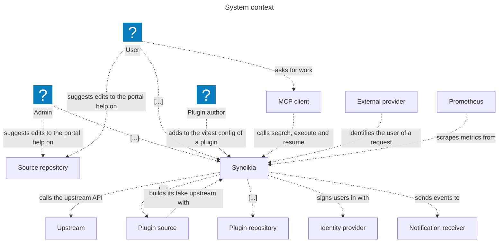
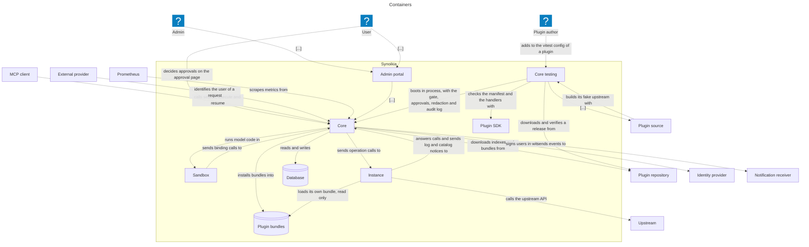
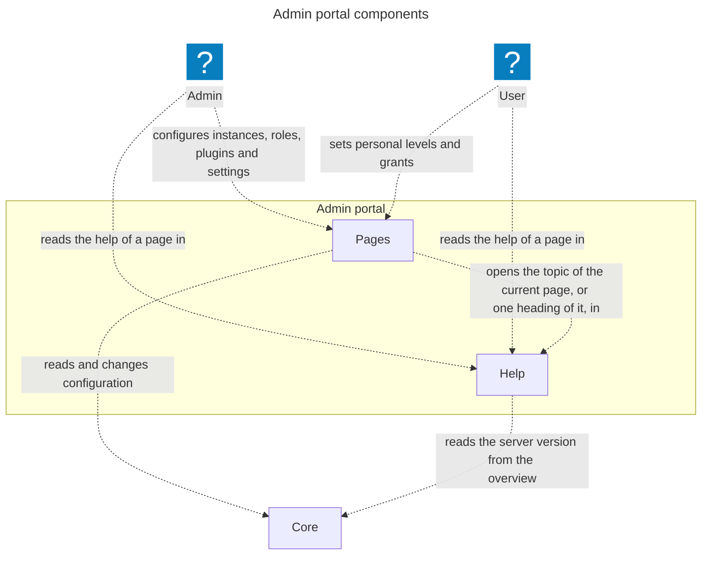
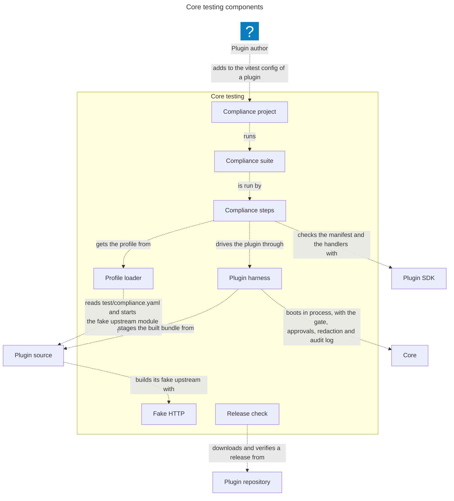
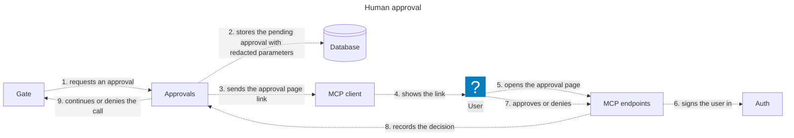
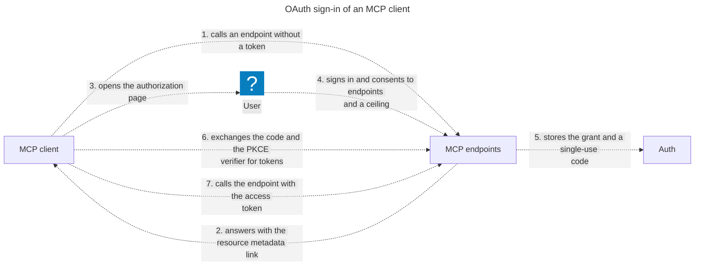
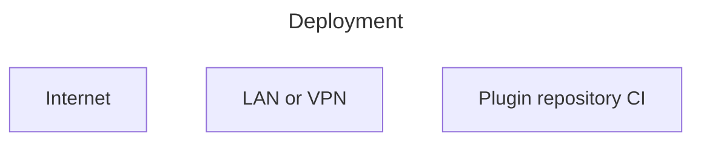

<!-- Generated by likec4 export markdown. Do not edit manually. -->

# Synoikia core

One MCP server for many self-hosted services, with one sandbox, permission gate, approval flow and audit log.

### System context

Who and what talks to Synoikia.

### Containers

The parts of Synoikia and what each one talks to.

### Core components

The modules of the core process.

```mermaid
---
title: "Core components"
---
graph TB
  Prometheus@{ shape: rectangle, label: "Prometheus" }
  SynoikiaSandbox@{ shape: rectangle, label: "Sandbox" }
  SynoikiaInstance@{ shape: rectangle, label: "Instance" }
  subgraph SynoikiaCore["`Core`"]
    SynoikiaCore.Metrics@{ shape: rectangle, label: "Metrics listener" }
    SynoikiaCore.Gate@{ shape: rectangle, label: "Gate" }
    SynoikiaCore.AdminApi@{ shape: rectangle, label: "Admin API" }
    SynoikiaCore.McpEndpoints@{ shape: rectangle, label: "MCP endpoints" }
    SynoikiaCore.Auth@{ shape: rectangle, label: "Auth" }
    SynoikiaCore.Instances@{ shape: rectangle, label: "Instance manager" }
    SynoikiaCore.Runtime@{ shape: rectangle, label: "Runtime" }
    SynoikiaCore.Approvals@{ shape: rectangle, label: "Approvals" }
    SynoikiaCore.Crypto@{ shape: rectangle, label: "Secret box" }
    SynoikiaCore.CatalogSync@{ shape: rectangle, label: "Catalog sync" }
    SynoikiaCore.Notify@{ shape: rectangle, label: "Notifications" }
    SynoikiaCore.PluginHost@{ shape: rectangle, label: "Plugin host" }
    SynoikiaCore.Audit@{ shape: rectangle, label: "Audit log" }
    SynoikiaCore.DbAccess@{ shape: rectangle, label: "Database access" }
  end
  IdentityProvider@{ shape: rectangle, label: "Identity provider" }
  NotificationReceiver@{ shape: rectangle, label: "Notification receiver" }
  PluginRepository@{ shape: rectangle, label: "Plugin repository" }
  SynoikiaBundles@{ shape: disk, label: "Plugin bundles" }
  SynoikiaDatabase@{ shape: disk, label: "Database" }
  Prometheus -. "`scrapes metrics from`" .-> SynoikiaCore.Metrics
  SynoikiaSandbox -. "`sends binding calls to`" .-> SynoikiaCore.Gate
  SynoikiaInstance -. "`answers calls and sends log, catalog and 
heartbeat notices to`" .-> SynoikiaCore.PluginHost
  SynoikiaCore.McpEndpoints -. "`authenticates the client and the 
approver with`" .-> SynoikiaCore.Auth
  SynoikiaCore.McpEndpoints -. "`starts search, execute and resume in`" .-> SynoikiaCore.Runtime
  SynoikiaCore.McpEndpoints -. "`records decisions from the approval page 
in`" .-> SynoikiaCore.Approvals
  SynoikiaCore.McpEndpoints -. "`looks up the instance of each endpoint 
in`" .-> SynoikiaCore.Instances
  SynoikiaCore.McpEndpoints -. "`emits an event for each refused agent 
credential on`" .-> SynoikiaCore.Notify
  SynoikiaCore.Metrics -. "`reads the open sessions and their apps 
at each scrape from`" .-> SynoikiaCore.McpEndpoints
  SynoikiaCore.AdminApi -. "`signs admins in with`" .-> SynoikiaCore.Auth
  SynoikiaCore.AdminApi -. "`sets the total of runs at once in`" .-> SynoikiaCore.Runtime
  SynoikiaCore.AdminApi -. "`configures instances in`" .-> SynoikiaCore.Instances
  SynoikiaCore.AdminApi -. "`[...]`" .-> SynoikiaCore.PluginHost
  SynoikiaCore.Metrics -. "`reads the instances and their states at 
each scrape from`" .-> SynoikiaCore.Instances
  SynoikiaCore.Metrics -. "`reads the installed plugins at each 
scrape from`" .-> SynoikiaCore.PluginHost
  SynoikiaCore.Metrics -. "`counts the call, approval and credential 
events of`" .-> SynoikiaCore.Notify
  SynoikiaCore.Auth -. "`[...]`" .-> SynoikiaCore.DbAccess
  SynoikiaCore.Runtime -. "`starts an idle instance for a guide read 
through`" .-> SynoikiaCore.PluginHost
  SynoikiaCore.Runtime -. "`reads the catalog for search from`" .-> SynoikiaCore.CatalogSync
  SynoikiaCore.Instances -. "`asks for the runs and parked executions 
of an instance in`" .-> SynoikiaCore.Runtime
  SynoikiaCore.Gate -. "`asks for human approval in`" .-> SynoikiaCore.Approvals
  SynoikiaCore.Gate -. "`[...]`" .-> SynoikiaCore.PluginHost
  SynoikiaCore.Gate -. "`reads operations and access levels from`" .-> SynoikiaCore.CatalogSync
  SynoikiaCore.Gate -. "`emits an event for each call, with its 
outcome and duration, on`" .-> SynoikiaCore.Notify
  SynoikiaCore.Gate -. "`records each decision in`" .-> SynoikiaCore.Audit
  SynoikiaCore.Approvals -. "`emits an event for each approval that 
ends on`" .-> SynoikiaCore.Notify
  SynoikiaCore.Approvals -. "`stores pending approvals through`" .-> SynoikiaCore.DbAccess
  SynoikiaCore.Instances -. "`asks for the open approvals of an 
instance in`" .-> SynoikiaCore.Approvals
  SynoikiaCore.Instances -. "`starts and stops instances with`" .-> SynoikiaCore.PluginHost
  SynoikiaCore.Instances -. "`[...]`" .-> SynoikiaCore.DbAccess
  SynoikiaCore.Instances -. "`encrypts connection secrets with`" .-> SynoikiaCore.Crypto
  SynoikiaCore.PluginHost -. "`reports each plugin message that breaks 
the contract to`" .-> SynoikiaCore.Instances
  SynoikiaCore.PluginHost -. "`warns of each refused debugger signal in`" .-> SynoikiaCore.Audit
  SynoikiaCore.CatalogSync -. "`reads catalogs and registries through`" .-> SynoikiaCore.PluginHost
  SynoikiaCore.CatalogSync -. "`[...]`" .-> SynoikiaCore.DbAccess
  SynoikiaCore.Audit -. "`appends through`" .-> SynoikiaCore.DbAccess
  SynoikiaCore.Auth -. "`signs users in with`" .-> IdentityProvider
  SynoikiaCore.Runtime -. "`runs model code in`" .-> SynoikiaSandbox
  SynoikiaCore.PluginHost -. "`downloads indexes and bundles from`" .-> PluginRepository
  SynoikiaCore.PluginHost -. "`sends operation calls to`" .-> SynoikiaInstance
  SynoikiaCore.PluginHost -. "`installs bundles into`" .-> SynoikiaBundles
  SynoikiaCore.Notify -. "`sends events to`" .-> NotificationReceiver
  SynoikiaCore.DbAccess -. "`reads and writes`" .-> SynoikiaDatabase
```

### Admin portal components

The parts of the admin portal and what each one talks to.

### Core testing components

The parts of the core testing package that a plugin author uses.

### execute through the gate

One binding call from model code to the upstream and back.

```mermaid
---
title: "execute through the gate"
---
graph LR
  McpClient@{ shape: rectangle, label: "MCP client" }
  SynoikiaCoreMcpEndpoints@{ shape: rectangle, label: "MCP endpoints" }
  SynoikiaCoreAuth@{ shape: rectangle, label: "Auth" }
  SynoikiaCoreRuntime@{ shape: rectangle, label: "Runtime" }
  SynoikiaSandbox@{ shape: rectangle, label: "Sandbox" }
  SynoikiaCoreGate@{ shape: rectangle, label: "Gate" }
  SynoikiaCorePluginHost@{ shape: rectangle, label: "Plugin host" }
  SynoikiaCoreApprovals@{ shape: rectangle, label: "Approvals" }
  SynoikiaInstance@{ shape: rectangle, label: "Instance" }
  Upstream@{ shape: rectangle, label: "Upstream" }
  SynoikiaCoreAudit@{ shape: rectangle, label: "Audit log" }
  McpClient -. "`1. calls execute with code`" .-> SynoikiaCoreMcpEndpoints
  SynoikiaCoreMcpEndpoints -. "`2. authenticates the client`" .-> SynoikiaCoreAuth
  SynoikiaCoreMcpEndpoints -. "`3. starts the execution`" .-> SynoikiaCoreRuntime
  SynoikiaCoreRuntime -. "`4. runs the code in a fresh isolate`" .-> SynoikiaSandbox
  SynoikiaSandbox -. "`5. calls a binding`" .-> SynoikiaCoreGate
  SynoikiaCoreGate -. "`6. resolves the operation and its 
targets`" .-> SynoikiaCorePluginHost
  SynoikiaCoreGate -. "`7. asks for a human approval when the 
access level is ask`" .-> SynoikiaCoreApprovals
  SynoikiaCoreGate -. "`8. invokes the operation`" .-> SynoikiaCorePluginHost
  SynoikiaCorePluginHost -. "`9. sends invoke`" .-> SynoikiaInstance
  SynoikiaInstance -. "`10. calls the upstream API`" .-> Upstream
  SynoikiaCoreGate -. "`11. records the decision and the 
redacted result`" .-> SynoikiaCoreAudit
  SynoikiaCoreGate -. "`12. returns the redacted result`" .-> SynoikiaSandbox
  SynoikiaCoreMcpEndpoints -. "`13. returns the tool result`" .-> McpClient
```

### Human approval

A call with access level ask waits until its user decides on the approval page.

### OAuth sign-in of an MCP client

The built-in authorization server gives an MCP client a token for chosen endpoints.

### Deployment

One container, its listeners and one data volume.

